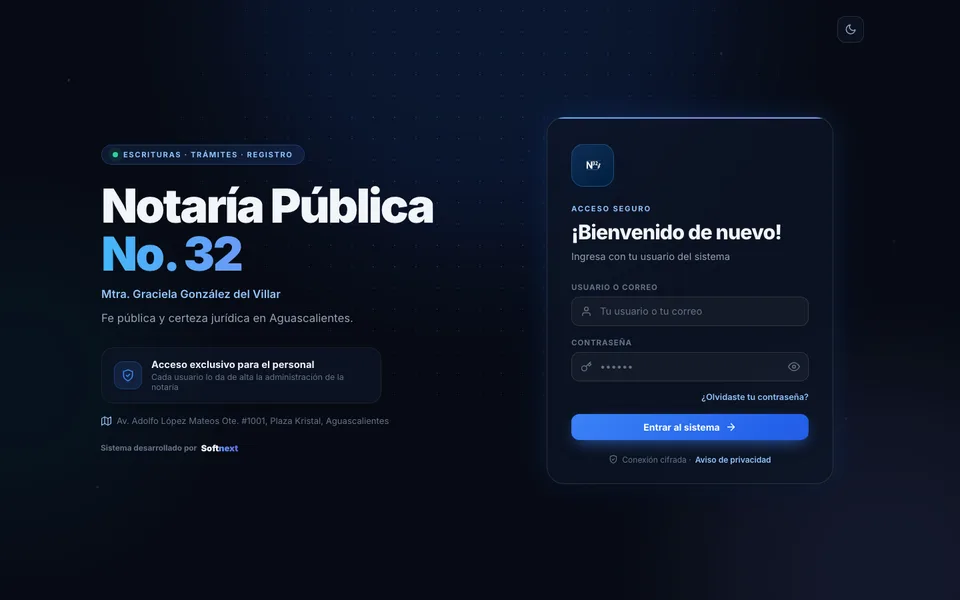
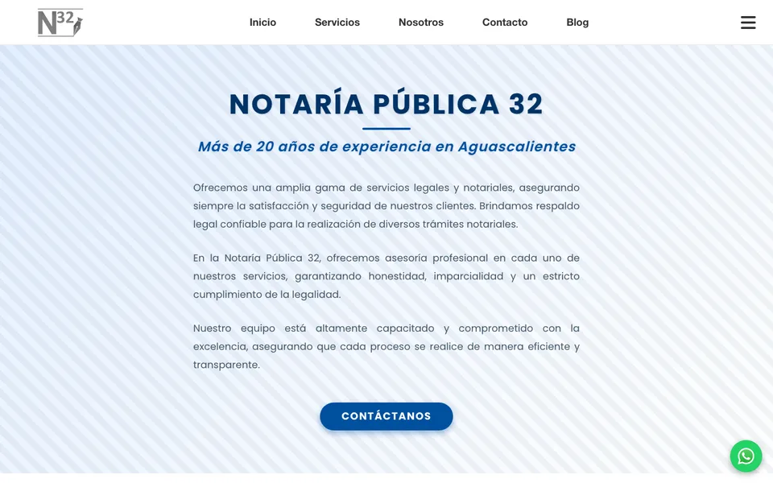
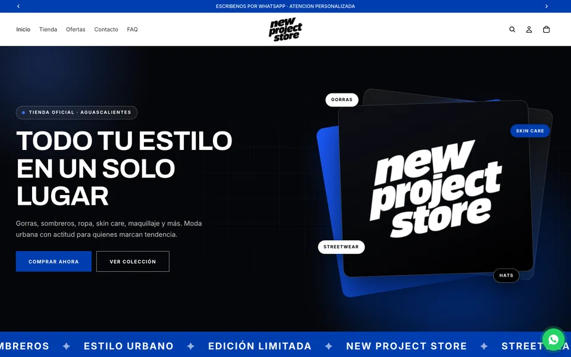
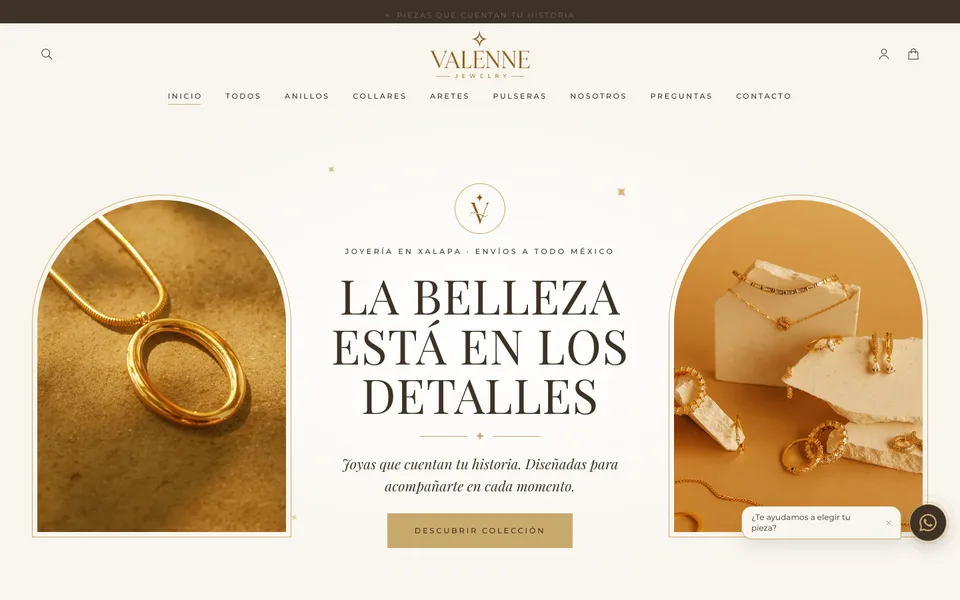

<div align="center">


<br/>

[](https://portafolio-sable-beta-42.vercel.app)
[](https://www.softnext.tech/)
[](https://linkedin.com/in/abraham-robledo-82a750271)
[](mailto:abrahamrobledo0402@gmail.com)

</div>

<br/>

## Sobre mí

<table>
<tr>
<td width="55%" valign="top">

Estudiante de **Ingeniería en Sistemas Computacionales** en la UAA y desarrollador full stack con **más de 2 años** construyendo software a medida para negocios en México.

Desde mi estudio **[Softnext](https://www.softnext.tech/)** he lanzado sistemas internos, sitios institucionales y tiendas en línea que hoy usan clientes reales.

- Promedio **9.65** · Intercambio en la **Universidad de Granada**, España
- **Desempeño Sobresaliente** en el EGEL-CENEVAL
- 3 credenciales de **AWS Academy** · **Scrum Fundamentals Certified**
- Abierto a oportunidades y proyectos freelance

</td>
<td width="45%" valign="top">

```ts
const abraham = {
  rol: "Full Stack Developer",
  base: "Aguascalientes, MX",
  frontend: ["React", "Angular", "Next.js", "Astro"],
  backend: ["Node.js", "FastAPI", "Supabase"],
  cloud: ["AWS", "Vercel", "Oracle Cloud"],
  ecommerce: ["Shopify", "Stripe"],
  aprendiendo: "Arquitectura cloud en AWS",
  cafe: Infinity,
};
```

</td>
</tr>
</table>

## Proyectos en producción

<table>
<tr>
<td width="50%" valign="top">
<a href="https://sistema.notaria32ags.com.mx/"></a>
<h3>Sistema de control de escrituras</h3>
<sub><b>Notaría Pública No. 32</b> · Aguascalientes</sub>
<p>Control de escrituras, trámites y registro con acceso por usuario, conexión cifrada y modo oscuro. Reemplazó el control en papel.</p>


<br/><br/>
<a href="https://sistema.notaria32ags.com.mx/"><b>Visitar sitio →</b></a>
</td>
<td width="50%" valign="top">
<a href="https://notaria32ags.com.mx/home"></a>
<h3>Sitio web institucional</h3>
<sub><b>Notaría Pública No. 32</b> · Aguascalientes</sub>
<p>Sitio oficial con catálogo de servicios notariales, blog, contacto por WhatsApp y diseño responsivo.</p>


<br/><br/>
<a href="https://notaria32ags.com.mx/home"><b>Visitar sitio →</b></a> · <a href="https://github.com/ARL150/Notaria-32">Código</a>
</td>
</tr>
<tr>
<td width="50%" valign="top">
<a href="https://newprojectstore.com.mx/"></a>
<h3>New Project Store</h3>
<sub><b>Tienda de moda urbana</b> · Aguascalientes</sub>
<p>Tienda en línea de gorras, ropa, skin care y más, con pagos en línea, cupón de bienvenida y envíos a todo México.</p>


<br/><br/>
<a href="https://newprojectstore.com.mx/"><b>Visitar sitio →</b></a>
</td>
<td width="50%" valign="top">
<a href="https://valenne.com.mx/"></a>
<h3>Valenne Jewelry</h3>
<sub><b>Joyería</b> · Xalapa, Veracruz · <i>Próximo lanzamiento</i></sub>
<p>Tienda de joyería con identidad visual en dorados y página de pre-lanzamiento con registro de correos.</p>


<br/><br/>
<a href="https://valenne.com.mx/"><b>Visitar sitio →</b></a>
</td>
</tr>
</table>

### Proyectos académicos

| Proyecto | Descripción | Stack |
|---|---|---|
| **[NovaPOS](https://github.com/ARL150/NovaPOS)** | Bases de datos distribuidas: 10 sucursales en 3 nodos primarios + nodo de recuperación, con replicación automática y roles. | `FastAPI` `React` `MongoDB` `Docker` |
| **[IDE Compiladores](https://github.com/ARL150/IDE-COMPILADORES)** | IDE con compilador propio: análisis léxico, sintáctico y semántico, tabla de símbolos, código intermedio y ejecución. | `Python` |
| **[IDS Institucional](https://github.com/ARL150/IDS-SEGURIDAD)** | Sistema de detección de intrusos en tiempo real para redes educativas: dispositivos no autorizados, listas blancas/negras, alertas y análisis forense. | `React` `FastAPI` `Python` |

## Stack

<div align="center">


<br/><br/>

<br/><br/>

<br/><br/>


</div>

## Certificaciones y logros

| | Credencial | Emisor | Año |
|:---:|---|---|:---:|
|  | [Cloud Operations](https://www.credly.com/go/sS10KkTq) · 40 h | AWS Academy | 2026 |
|  | [Cloud Security Foundations](https://www.credly.com/go/qt5OgbkG) · 20 h | AWS Academy | 2026 |
|  | [Cloud Foundations](https://www.credly.com/go/CkYnn8TN) · 20 h | AWS Academy | 2026 |
|  | Scrum Fundamentals Certified (SFC™) | SCRUMstudy | 2026 |
|  | Testimonio de Desempeño Sobresaliente · Ing. Computacional | CENEVAL | 2026 |
|  | Oracle Cloud Foundations | Oracle (Mentorías) | 2025 |

## Actividad

<div align="center">

<picture>
  <source media="(prefers-color-scheme: dark)" srcset="https://streak-stats.demolab.com?user=ARL150&locale=es&hide_border=true&background=0D1117&ring=6366F1&fire=A78BFA&currStreakLabel=A78BFA&sideNums=E6EDF3&currStreakNum=E6EDF3&sideLabels=8B949E&dates=8B949E&stroke=30363D" />
  
</picture>

<br/><br/>

<picture>
  <source media="(prefers-color-scheme: dark)" srcset="https://raw.githubusercontent.com/ARL150/ARL150/output/github-snake-dark.svg" />
  
</picture>

<br/>


</div>

---

<div align="center">

**¿Tienes un proyecto en mente? Hablemos.**

[](https://portafolio-sable-beta-42.vercel.app)
[](mailto:abrahamrobledo0402@gmail.com)

</div>


